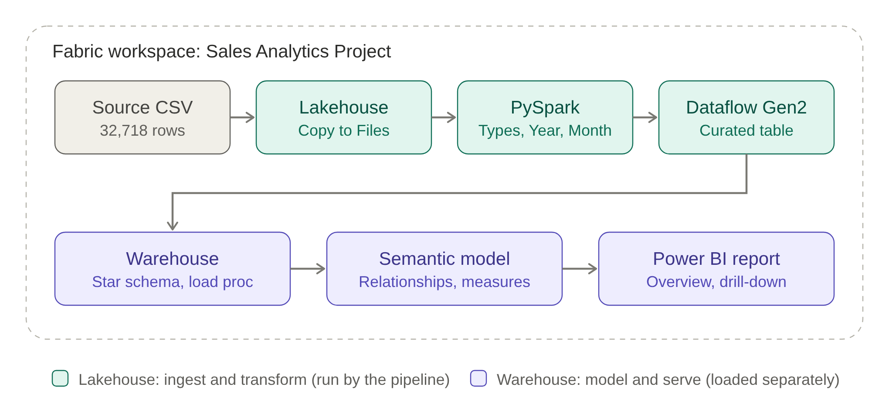
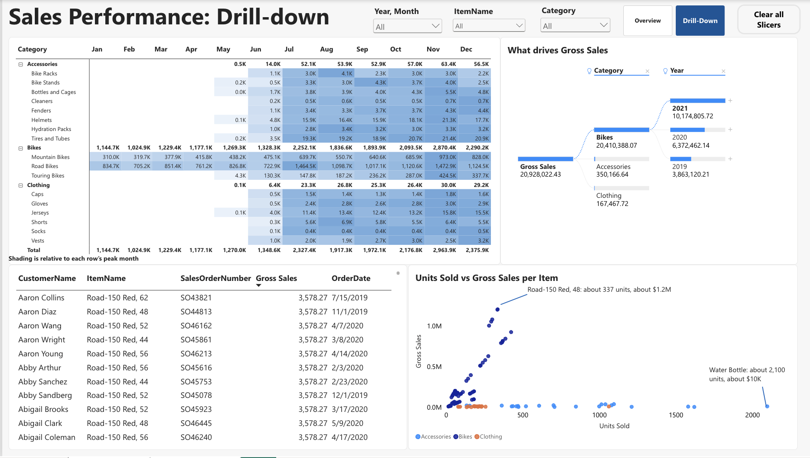

# Microsoft Fabric Sales Analytics Platform

## Overview

An end-to-end analytics solution built in Microsoft Fabric. A 32,718-line sales CSV is ingested into a Lakehouse, cleaned with PySpark, enriched with Dataflow Gen2, modelled as a star schema in a Warehouse, and served through a semantic model to a two-page Power BI report covering $20.9M of revenue.

> Portfolio: https://aashima-91.github.io/aashimagupta.github.io/

### Tech Stack

- Microsoft Fabric
- Lakehouse
- Data Pipeline
- PySpark
- Dataflow Gen2
- Data Warehouse
- Semantic Model
- Power BI
- DAX
- T-SQL

---

PDF export: docs/Sales_Dashboard.pdf

Overview page: KPI cards (gross sales, units sold, order count, average order value, tax), top 5 items, a gross sales trend you can drill from year to quarter to month (the title changes with the drill level), quarterly sales, and a top 10 customers table with data bars.

Drill-down page: a category and subcategory heatmap by month, a decomposition tree, a customer detail table (a drill-through target) and a scatter plot of units sold against gross sales per item, coloured by category.

---

## Architecture

---

## Business Problem

The business needed a centralized analytics solution to:

- Track sales performance
- Monitor revenue growth
- Understand customer behaviour
- Identify top-selling products
- Support data-driven decision making

---

## Solution

Implemented an end-to-end analytics platform in Microsoft Fabric:

1. Ingest sales CSV into Lakehouse
2. Transform data using PySpark
3. Enrich records using Dataflow Gen2
4. Build a Warehouse star schema
5. Create semantic model and DAX measures
6. Deliver insights through Power BI

---

## Key Results

- $20.9M total revenue analyzed
- 32,718 sales transactions processed
- 67.8% YoY growth from 2020 to 2021
- 97.5% of revenue generated by Bikes

---

Data

The pipeline loads the companion SalesData.csv. That file is an exact file-extension conversion of the project's RawGithubUserContent.txt, not a fabricated dataset, and it must be loaded unedited and unanonymised to reproduce the expected counts (32,718 rows; 1,201 / 2,733 / 28,784 by year). It has nine columns and covers 1 July 2019 to 31 December 2021. Customer details look synthetic (emails use the adventure-works.com domain).

The full file is not included in this repository. data/sample_SalesData.csv is a modified 100-row stratified sample (emails replaced by customerNNN@example.com) for illustration only; it will not reproduce the counts or dashboard figures. See data/data_dictionary.md for every column and table.

---

## Dashboard

## Overview Page

## Drilldown Page

---

## Skills Demonstrated

- Microsoft Fabric
- Data Engineering
- Lakehouse Architecture
- PySpark
- Data Modelling
- DAX
- Power BI
- SQL
